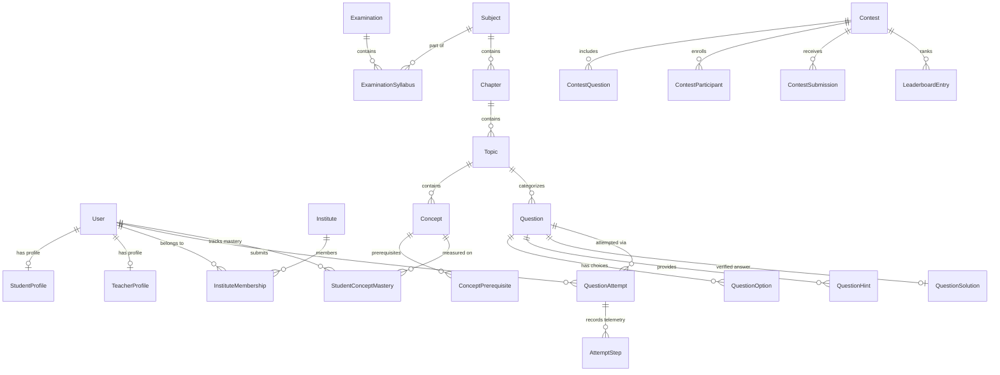

# Database Schema Specification
## AI-Powered Competitive Exam Problem-Solving Platform

**Database Engine:** PostgreSQL 15+  
**ORM:** Prisma ORM  
**Architecture:** Relational, Multi-Tenant Ready (Role & Institute Scoped), Normalized with Auditing

---

## 1. Overview & Design Principles

The database is designed to support high-throughput question-solving sessions, granular student telemetry, adaptive learning algorithms, multi-level concept graphs, competitive contest leaderboards, and role-based access for multi-tenant coaching institutes.

### Key Architectural Tenets:
1. **Deterministic Evaluation & History Preservation:** Question versions are tracked so question revisions never invalidate historical student attempts or analytics.
2. **Concept Dependency Directed Graph:** Concepts maintain prerequisite relationships (`ConceptPrerequisite`) to power diagnostic gap detection and adaptive recommendations.
3. **Multi-Level Hint & Solution Isolation:** Hints (`QuestionHint`) are stored by level (1 to 4) and retrieved on-demand; full solutions (`QuestionSolution`) are strictly locked until verified post-submission criteria are met.
4. **Tenant-Safe Partitioning:** Institute data, student memberships, and contests are strictly isolated by `instituteId` foreign keys and checked via row-level authorization middleware.
5. **Precision & Consistency:** Timestamps are stored in UTC (`TIMESTAMPTZ`), float tolerances are explicitly defined for numerical questions, and high-frequency metrics are aggregated into mastery tables (`StudentConceptMastery`).

---

## 2. Entity-Relationship Overview

---

## 3. Data Dictionary & Table Definitions

### 3.1 Authentication & User Management

#### `User`
Primary user table for all roles.
| Column | Type | Constraints | Description |
|---|---|---|---|
| `id` | UUID | PRIMARY KEY, DEFAULT gen_random_uuid() | Unique user identifier |
| `email` | VARCHAR(255) | UNIQUE, NOT NULL | Account email address |
| `passwordHash` | VARCHAR(255) | NOT NULL | Argon2id / bcrypt hashed password |
| `fullName` | VARCHAR(120) | NOT NULL | User's full name |
| `avatarUrl` | TEXT | NULLABLE | CDN URL for profile avatar |
| `role` | ENUM(`STUDENT`, `TEACHER`, `INSTITUTE_ADMIN`, `PLATFORM_ADMIN`) | NOT NULL, DEFAULT `STUDENT` | RBAC role |
| `isEmailVerified` | BOOLEAN | NOT NULL, DEFAULT FALSE | Email verification status |
| `isActive` | BOOLEAN | NOT NULL, DEFAULT TRUE | Account state |
| `lastLoginAt` | TIMESTAMPTZ | NULLABLE | Last login timestamp |
| `createdAt` | TIMESTAMPTZ | NOT NULL, DEFAULT NOW() | Timestamp created |
| `updatedAt` | TIMESTAMPTZ | NOT NULL, DEFAULT NOW() | Timestamp updated |

#### `StudentProfile`
Extended student academic profile.
| Column | Type | Constraints | Description |
|---|---|---|---|
| `id` | UUID | PRIMARY KEY, DEFAULT gen_random_uuid() | Unique profile ID |
| `userId` | UUID | UNIQUE, FK -> `User(id)` ON DELETE CASCADE | Student user reference |
| `targetExam` | ENUM(`JEE_MAIN`, `JEE_ADVANCED`, `NEET`, `BOTH_JEE`) | NOT NULL | Primary target examination |
| `targetYear` | INTEGER | NOT NULL | Target examination year (e.g., 2026, 2027) |
| `academicLevel` | VARCHAR(50) | NOT NULL | Class 11, Class 12, Dropper/Repeater |
| `preferredSubjects` | VARCHAR(50)[] | NOT NULL, DEFAULT '{"Physics"}' | Target subjects list |
| `dailyGoalQuestions`| INTEGER | NOT NULL, DEFAULT 15 | Daily questions goal |
| `currentStreak` | INTEGER | NOT NULL, DEFAULT 0 | Active consecutive practice days |
| `longestStreak` | INTEGER | NOT NULL, DEFAULT 0 | Maximum consecutive practice days |
| `problemSolvingIndex`| DECIMAL(5,2) | NOT NULL, DEFAULT 0.00 | Calculated PSI score (0 - 100) |
| `createdAt` | TIMESTAMPTZ | NOT NULL, DEFAULT NOW() | Timestamp created |
| `updatedAt` | TIMESTAMPTZ | NOT NULL, DEFAULT NOW() | Timestamp updated |

#### `Institute`
Coaching institute or organizational tenant.
| Column | Type | Constraints | Description |
|---|---|---|---|
| `id` | UUID | PRIMARY KEY, DEFAULT gen_random_uuid() | Unique institute ID |
| `name` | VARCHAR(200) | NOT NULL | Institute legal/display name |
| `slug` | VARCHAR(100) | UNIQUE, NOT NULL | URL-friendly slug identifier |
| `code` | VARCHAR(30) | UNIQUE, NOT NULL | Institute enrollment code |
| `logoUrl` | TEXT | NULLABLE | Logo asset URL |
| `website` | VARCHAR(255) | NULLABLE | Official website URL |
| `isVerified` | BOOLEAN | NOT NULL, DEFAULT FALSE | Administrative verification badge |
| `createdAt` | TIMESTAMPTZ | NOT NULL, DEFAULT NOW() | Timestamp created |
| `updatedAt` | TIMESTAMPTZ | NOT NULL, DEFAULT NOW() | Timestamp updated |

#### `InstituteMembership`
Maps users (students, teachers, institute admins) to an institute.
| Column | Type | Constraints | Description |
|---|---|---|---|
| `id` | UUID | PRIMARY KEY, DEFAULT gen_random_uuid() | Unique membership ID |
| `userId` | UUID | FK -> `User(id)` ON DELETE CASCADE | Member user |
| `instituteId` | UUID | FK -> `Institute(id)` ON DELETE CASCADE | Institute entity |
| `roleInInstitute` | ENUM(`STUDENT`, `TEACHER`, `ADMIN`) | NOT NULL | Role inside institute |
| `batchName` | VARCHAR(100) | NULLABLE | Student batch identifier (e.g. Apex-2026) |
| `status` | ENUM(`PENDING`, `ACTIVE`, `SUSPENDED`) | NOT NULL, DEFAULT `ACTIVE` | Membership status |
| `joinedAt` | TIMESTAMPTZ | NOT NULL, DEFAULT NOW() | Enrollment date |
| *Indexes:* | UNIQUE(`userId`, `instituteId`) | | Prevents duplicate user memberships |

---

### 3.2 Syllabus, Knowledge Graph & Prerequisite Hierarchy

#### `Examination`
| Column | Type | Constraints | Description |
|---|---|---|---|
| `id` | UUID | PRIMARY KEY, DEFAULT gen_random_uuid() | Unique exam ID |
| `code` | VARCHAR(50) | UNIQUE, NOT NULL | Code identifier (e.g., `JEE_MAIN`, `JEE_ADVANCED`) |
| `name` | VARCHAR(150) | NOT NULL | Display name (e.g., Joint Entrance Examination Main) |
| `description` | TEXT | NULLABLE | Examination description |
| `isActive` | BOOLEAN | NOT NULL, DEFAULT TRUE | Status flag |

#### `Subject`
| Column | Type | Constraints | Description |
|---|---|---|---|
| `id` | UUID | PRIMARY KEY, DEFAULT gen_random_uuid() | Subject ID |
| `name` | VARCHAR(100) | UNIQUE, NOT NULL | Subject name (e.g. `Physics`, `Mathematics`) |
| `slug` | VARCHAR(100) | UNIQUE, NOT NULL | URL slug (e.g. `physics`) |
| `displayOrder` | INTEGER | NOT NULL, DEFAULT 0 | Ordering index |

#### `Chapter`
| Column | Type | Constraints | Description |
|---|---|---|---|
| `id` | UUID | PRIMARY KEY, DEFAULT gen_random_uuid() | Chapter ID |
| `subjectId` | UUID | FK -> `Subject(id)` ON DELETE CASCADE | Parent subject |
| `name` | VARCHAR(150) | NOT NULL | Chapter name (e.g. `Kinematics`, `Laws of Motion`) |
| `slug` | VARCHAR(150) | NOT NULL | URL slug (e.g. `kinematics`) |
| `description` | TEXT | NULLABLE | Chapter scope summary |
| `displayOrder` | INTEGER | NOT NULL, DEFAULT 0 | Sorting sequence |
| *Indexes:* | UNIQUE(`subjectId`, `slug`) | | Scope slug uniqueness per subject |

#### `Topic`
| Column | Type | Constraints | Description |
|---|---|---|---|
| `id` | UUID | PRIMARY KEY, DEFAULT gen_random_uuid() | Topic ID |
| `chapterId` | UUID | FK -> `Chapter(id)` ON DELETE CASCADE | Parent chapter |
| `name` | VARCHAR(150) | NOT NULL | Topic name (e.g. `Projectiles on an Inclined Plane`) |
| `slug` | VARCHAR(150) | NOT NULL | URL slug |
| `displayOrder` | INTEGER | NOT NULL, DEFAULT 0 | Sorting sequence |

#### `Concept`
Smallest atomic knowledge unit for gap diagnosis.
| Column | Type | Constraints | Description |
|---|---|---|---|
| `id` | UUID | PRIMARY KEY, DEFAULT gen_random_uuid() | Concept ID |
| `topicId` | UUID | FK -> `Topic(id)` ON DELETE CASCADE | Parent topic |
| `code` | VARCHAR(100) | UNIQUE, NOT NULL | Machine tag (e.g. `PHY-KIN-PROJ-INCL`) |
| `name` | VARCHAR(200) | NOT NULL | Concept name |
| `summary` | TEXT | NOT NULL | Formal physics definition / formula core |
| `importanceWeight`| DECIMAL(3,2) | NOT NULL, DEFAULT 1.00 | Exam weight factor |

#### `ConceptPrerequisite`
Directed graph mapping concept dependencies.
| Column | Type | Constraints | Description |
|---|---|---|---|
| `id` | UUID | PRIMARY KEY, DEFAULT gen_random_uuid() | Prerequisite record ID |
| `conceptId` | UUID | FK -> `Concept(id)` ON DELETE CASCADE | Target concept (e.g. `Rotational Motion`) |
| `prerequisiteId` | UUID | FK -> `Concept(id)` ON DELETE CASCADE | Required foundational concept (e.g. `Circular Motion`) |
| `dependencyStrength`| ENUM(`HARD`, `SOFT`, `HELPFUL`) | NOT NULL, DEFAULT `HARD` | Dependency strictness |
| *Indexes:* | UNIQUE(`conceptId`, `prerequisiteId`) | | Directed edge uniqueness |

---

### 3.3 Question Bank & Content Engine

#### `Question`
Core question definition with versioning support.
| Column | Type | Constraints | Description |
|---|---|---|---|
| `id` | UUID | PRIMARY KEY, DEFAULT gen_random_uuid() | Question ID |
| `code` | VARCHAR(50) | UNIQUE, NOT NULL | Public reference code (e.g. `PHY-ADV-2024-001`) |
| `topicId` | UUID | FK -> `Topic(id)` | Topic taxonomy mapping |
| `primaryConceptId` | UUID | FK -> `Concept(id)` | Primary concept tested |
| `examType` | ENUM(`JEE_MAIN`, `JEE_ADVANCED`, `BOTH`) | NOT NULL | Target exam format |
| `questionType` | ENUM(`SINGLE_CORRECT`, `MULTIPLE_CORRECT`, `NUMERICAL`, `INTEGER`, `ASSERTION_REASON`) | NOT NULL | Answer format |
| `difficulty` | ENUM(`EASY`, `MEDIUM`, `HARD`, `ADVANCED`) | NOT NULL | Calibrated difficulty |
| `contentLatex` | TEXT | NOT NULL | Question statement in markdown + LaTeX |
| `imageUrl` | TEXT | NULLABLE | Diagram / figure CDN URL |
| `marks` | DECIMAL(4,2) | NOT NULL, DEFAULT 4.00 | Full marks awarded on correct solve |
| `negativeMarks` | DECIMAL(4,2) | NOT NULL, DEFAULT 1.00 | Deduction on incorrect submission |
| `timeRecommendationSec`| INTEGER | NOT NULL, DEFAULT 180 | Expected solving time (in seconds) |
| `isPYQ` | BOOLEAN | NOT NULL, DEFAULT FALSE | Previous Year Question indicator |
| `pyqYear` | INTEGER | NULLABLE | PYQ examination year (e.g. 2023) |
| `sourceAttribution` | VARCHAR(255) | NULLABLE | Citation/Source tag |
| `status` | ENUM(`DRAFT`, `VERIFIED`, `PUBLISHED`, `ARCHIVED`) | NOT NULL, DEFAULT `DRAFT` | Publishing lifecycle state |
| `version` | INTEGER | NOT NULL, DEFAULT 1 | Version sequence for immutability |
| `numericalAnswer` | DECIMAL(12,4) | NULLABLE | Target value for numerical problems |
| `numericalTolerance`| DECIMAL(8,4) | NULLABLE, DEFAULT 0.05 | Allowable absolute delta (e.g. $\pm 0.05$) |
| `unit` | VARCHAR(30) | NULLABLE | Standard physical SI unit |
| `createdById` | UUID | FK -> `User(id)` | Author/Curator |
| `createdAt` | TIMESTAMPTZ | NOT NULL, DEFAULT NOW() | Creation timestamp |
| `updatedAt` | TIMESTAMPTZ | NOT NULL, DEFAULT NOW() | Modification timestamp |

#### `QuestionOption`
Options for MCQ and Multiple-Correct questions.
| Column | Type | Constraints | Description |
|---|---|---|---|
| `id` | UUID | PRIMARY KEY, DEFAULT gen_random_uuid() | Option ID |
| `questionId` | UUID | FK -> `Question(id)` ON DELETE CASCADE | Parent question |
| `optionKey` | VARCHAR(4) | NOT NULL | Option letter (`A`, `B`, `C`, `D`) |
| `contentLatex` | TEXT | NOT NULL | Option text in LaTeX / Markdown |
| `imageUrl` | TEXT | NULLABLE | Optional diagram for this option |
| `isCorrect` | BOOLEAN | NOT NULL | Truth flag (never revealed to frontend pre-submit) |
| `displayOrder` | INTEGER | NOT NULL, DEFAULT 0 | Presentation order |
| *Indexes:* | UNIQUE(`questionId`, `optionKey`) | | Option key uniqueness per question |

#### `QuestionHint`
Graduated, progressive hint tiers for intelligent mentoring.
| Column | Type | Constraints | Description |
|---|---|---|---|
| `id` | UUID | PRIMARY KEY, DEFAULT gen_random_uuid() | Hint ID |
| `questionId` | UUID | FK -> `Question(id)` ON DELETE CASCADE | Question reference |
| `level` | INTEGER | NOT NULL | Level 1: Direction, 2: Formula, 3: Application, 4: Guided step |
| `hintTextLatex` | TEXT | NOT NULL | Hint explanation in Markdown + LaTeX |
| `penaltyFraction`| DECIMAL(3,2) | NOT NULL, DEFAULT 0.00 | Optional score deduction fraction (0.0 - 0.25) |
| *Indexes:* | UNIQUE(`questionId`, `level`) | | Enforces one hint per level |

#### `QuestionSolution`
Verified editorial solution and concept recap.
| Column | Type | Constraints | Description |
|---|---|---|---|
| `id` | UUID | PRIMARY KEY, DEFAULT gen_random_uuid() | Solution record ID |
| `questionId` | UUID | UNIQUE, FK -> `Question(id)` ON DELETE CASCADE | Question mapping (1:1) |
| `solutionTextLatex`| TEXT | NOT NULL | Comprehensive step-by-step verified solution |
| `verifiedById` | UUID | FK -> `User(id)` | SME/Admin who verified accuracy |
| `keyFormulas` | TEXT[] | NOT NULL, DEFAULT '{}' | List of governing formulas invoked |
| `commonPitfalls`| TEXT | NULLABLE | Analysis of typical student misunderstandings |
| `createdAt` | TIMESTAMPTZ | NOT NULL, DEFAULT NOW() | Timestamp created |

---

### 3.4 Student Attempts, Telemetry & Mastery

#### `QuestionAttempt`
Atomic record of a student attempt.
| Column | Type | Constraints | Description |
|---|---|---|---|
| `id` | UUID | PRIMARY KEY, DEFAULT gen_random_uuid() | Attempt unique ID |
| `userId` | UUID | FK -> `User(id)` ON DELETE CASCADE | Student user |
| `questionId` | UUID | FK -> `Question(id)` ON DELETE CASCADE | Attempted question |
| `isCorrect` | BOOLEAN | NOT NULL | Evaluation outcome |
| `marksEarned` | DECIMAL(4,2) | NOT NULL | Points awarded or deducted |
| `timeSpentSeconds`| INTEGER | NOT NULL | Active duration before submission |
| `submittedAnswer`| JSONB | NOT NULL | Array of selected keys or numerical float |
| `hintsRequested` | INTEGER | NOT NULL, DEFAULT 0 | Count of progressive hints requested (0 - 4) |
| `diagnosedMistake`| ENUM(`NONE`, `CONCEPTUAL`, `FORMULA_SELECTION`, `CALCULATION`, `SIGN_CONVENTION`, `UNIT_CONVERSION`, `QUESTION_INTERPRETATION`, `PREREQUISITE_GAP`, `TIME_MANAGEMENT`) | NOT NULL, DEFAULT `NONE` | Diagnosed mistake class |
| `aiMentorFeedback`| TEXT | NULLABLE | AI diagnostic summary generated post-attempt |
| `createdAt` | TIMESTAMPTZ | NOT NULL, DEFAULT NOW() | Attempt submission time |
| *Indexes:* | INDEX(`userId`, `createdAt`), INDEX(`questionId`, `isCorrect`) | | High-performance analytics retrieval |

#### `AttemptStep`
Interactive scratchpad / reasoning telemetry logged prior to final submission.
| Column | Type | Constraints | Description |
|---|---|---|---|
| `id` | UUID | PRIMARY KEY, DEFAULT gen_random_uuid() | Step record ID |
| `attemptId` | UUID | FK -> `QuestionAttempt(id)` ON DELETE CASCADE | Attempt session |
| `stepNumber` | INTEGER | NOT NULL | Step sequence number |
| `studentInput` | TEXT | NOT NULL | Text/Formula typed in scratchpad |
| `aiFeedback` | TEXT | NULLABLE | Real-time interactive feedback from mentor |
| `createdAt` | TIMESTAMPTZ | NOT NULL, DEFAULT NOW() | Step timestamp |

#### `StudentConceptMastery`
Aggregated mastery metrics updated after every evaluated attempt.
| Column | Type | Constraints | Description |
|---|---|---|---|
| `id` | UUID | PRIMARY KEY, DEFAULT gen_random_uuid() | Record ID |
| `userId` | UUID | FK -> `User(id)` ON DELETE CASCADE | Student user |
| `conceptId` | UUID | FK -> `Concept(id)` ON DELETE CASCADE | Knowledge concept |
| `attemptsCount` | INTEGER | NOT NULL, DEFAULT 0 | Total questions attempted |
| `correctCount` | INTEGER | NOT NULL, DEFAULT 0 | Correctly solved count |
| `accuracy` | DECIMAL(5,2) | NOT NULL, DEFAULT 0.00 | Success rate percentage |
| `difficultyScore`| DECIMAL(5,2) | NOT NULL, DEFAULT 0.00 | Weighted difficulty-adjusted score |
| `masteryLevel` | ENUM(`NOVICE`, `DEVELOPING`, `COMPETENT`, `PROFICIENT`, `MASTERED`) | NOT NULL, DEFAULT `NOVICE` | Categorical mastery tier |
| `lastAttemptAt` | TIMESTAMPTZ | NULLABLE | Last practice timestamp |
| `retentionHealth`| DECIMAL(3,2) | NOT NULL, DEFAULT 1.00 | Forgetting-curve decay factor (0.00 - 1.00) |
| *Indexes:* | UNIQUE(`userId`, `conceptId`) | | One composite mastery per student-concept |

#### `Bookmark`
Student-saved questions for revision.
| Column | Type | Constraints | Description |
|---|---|---|---|
| `id` | UUID | PRIMARY KEY, DEFAULT gen_random_uuid() | Bookmark ID |
| `userId` | UUID | FK -> `User(id)` ON DELETE CASCADE | Student user |
| `questionId` | UUID | FK -> `Question(id)` ON DELETE CASCADE | Saved question |
| `notes` | TEXT | NULLABLE | Student private revision note |
| `createdAt` | TIMESTAMPTZ | NOT NULL, DEFAULT NOW() | Bookmark timestamp |
| *Indexes:* | UNIQUE(`userId`, `questionId`) | | Prevents duplicate bookmarks |

---

### 3.5 Contests, Leaderboards & Scholarships

#### `Contest`
Timed competitive exam or challenge.
| Column | Type | Constraints | Description |
|---|---|---|---|
| `id` | UUID | PRIMARY KEY, DEFAULT gen_random_uuid() | Contest ID |
| `title` | VARCHAR(200) | NOT NULL | Contest title |
| `slug` | VARCHAR(200) | UNIQUE, NOT NULL | URL identifier |
| `description` | TEXT | NULLABLE | Contest rules and details |
| `examType` | ENUM(`JEE_MAIN`, `JEE_ADVANCED`, `NEET`) | NOT NULL | Format template |
| `startTime` | TIMESTAMPTZ | NOT NULL | Scheduled start |
| `endTime` | TIMESTAMPTZ | NOT NULL | Scheduled close |
| `durationMinutes` | INTEGER | NOT NULL | Time limit per student session (e.g. 180 min) |
| `totalMarks` | DECIMAL(6,2) | NOT NULL | Maximum aggregate marks |
| `instituteId` | UUID | NULLABLE, FK -> `Institute(id)` | Institute-private contest if set, else Global |
| `isPublished` | BOOLEAN | NOT NULL, DEFAULT FALSE | Visibility status |
| `createdAt` | TIMESTAMPTZ | NOT NULL, DEFAULT NOW() | Timestamp created |

#### `ContestQuestion`
Questions assigned to a contest with ordering.
| Column | Type | Constraints | Description |
|---|---|---|---|
| `id` | UUID | PRIMARY KEY, DEFAULT gen_random_uuid() | Entry ID |
| `contestId` | UUID | FK -> `Contest(id)` ON DELETE CASCADE | Parent contest |
| `questionId` | UUID | FK -> `Question(id)` ON DELETE CASCADE | Question reference |
| `sectionName` | VARCHAR(100) | NOT NULL, DEFAULT 'Physics' | Exam section |
| `orderIndex` | INTEGER | NOT NULL | Display order in exam paper |
| *Indexes:* | UNIQUE(`contestId`, `questionId`), UNIQUE(`contestId`, `orderIndex`) | | Ordering and integrity |

#### `ContestParticipant`
Registration and session state for a contest taker.
| Column | Type | Constraints | Description |
|---|---|---|---|
| `id` | UUID | PRIMARY KEY, DEFAULT gen_random_uuid() | Participant record |
| `contestId` | UUID | FK -> `Contest(id)` ON DELETE CASCADE | Contest |
| `userId` | UUID | FK -> `User(id)` ON DELETE CASCADE | Registered student |
| `startedAt` | TIMESTAMPTZ | NULLABLE | First session start timestamp |
| `submittedAt` | TIMESTAMPTZ | NULLABLE | Final paper submit timestamp |
| `score` | DECIMAL(6,2) | NOT NULL, DEFAULT 0.00 | Total marks scored |
| `rank` | INTEGER | NULLABLE | Final calculated rank |
| `status` | ENUM(`REGISTERED`, `IN_PROGRESS`, `SUBMITTED`, `DISQUALIFIED`) | NOT NULL, DEFAULT `REGISTERED` | Lifecycle status |
| *Indexes:* | UNIQUE(`contestId`, `userId`) | | One registration per contest |

#### `LeaderboardEntry`
Snapshot rankings for high-performance retrieval.
| Column | Type | Constraints | Description |
|---|---|---|---|
| `id` | UUID | PRIMARY KEY, DEFAULT gen_random_uuid() | Record ID |
| `contestId` | UUID | FK -> `Contest(id)` ON DELETE CASCADE | Associated contest |
| `userId` | UUID | FK -> `User(id)` ON DELETE CASCADE | Student user |
| `score` | DECIMAL(6,2) | NOT NULL | Calculated score |
| `totalTimeSeconds`| INTEGER | NOT NULL | Tie-breaking duration |
| `rank` | INTEGER | NOT NULL | Official rank |
| `calculatedAt` | TIMESTAMPTZ | NOT NULL, DEFAULT NOW() | Generation timestamp |
| *Indexes:* | INDEX(`contestId`, `rank`) | | Fast page-wise leaderboard queries |

---

### 3.6 Auditing & System Logs

#### `AuditLog`
Compliance and security tracking for administrative and grading actions.
| Column | Type | Constraints | Description |
|---|---|---|---|
| `id` | UUID | PRIMARY KEY, DEFAULT gen_random_uuid() | Audit event ID |
| `actorId` | UUID | FK -> `User(id)` | User performing the action |
| `action` | VARCHAR(100) | NOT NULL | e.g., `QUESTION_CREATE`, `CONTEST_EDIT`, `GRADE_OVERRIDE` |
| `resourceType` | VARCHAR(50) | NOT NULL | e.g., `Question`, `Contest`, `User` |
| `resourceId` | VARCHAR(100) | NOT NULL | Affected resource ID |
| `payload` | JSONB | NULLABLE | Event diff or metadata |
| `ipAddress` | VARCHAR(45) | NULLABLE | Client IP address |
| `createdAt` | TIMESTAMPTZ | NOT NULL, DEFAULT NOW() | Event timestamp |

---

## 4. Indexing Strategy & Performance Considerations

1. **Composite Indexes for Student Activity:**
   - `QuestionAttempt(userId, createdAt DESC)`: Enables instantaneous rendering of the student dashboard's recent activity and streak queries.
   - `QuestionAttempt(questionId, isCorrect)`: Provides rapid calculation of question difficulty acceptance rates ($P$-value).
2. **Deterministic Lookups:**
   - `Question(topicId, difficulty, status)`: Powers the adaptive question recommendation engine to fetch candidate unattempted questions with zero full-table scans.
3. **Multi-Tenant Protection:**
   - `InstituteMembership(instituteId, roleInInstitute)`: Accelerates institute teacher and student roster lookups while ensuring cross-tenant isolation.
