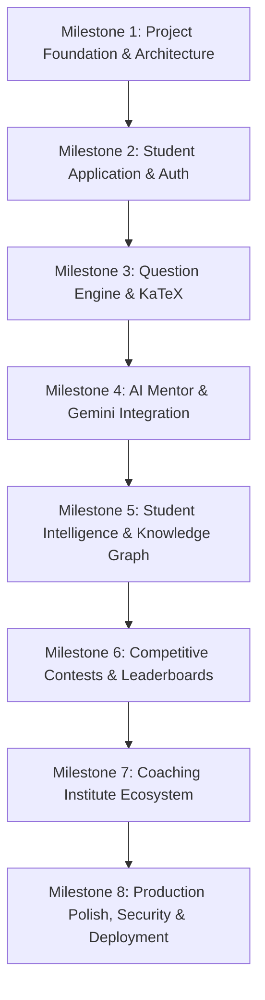

# Project Roadmap & Implementation Milestones
## AI-Powered Competitive Exam Problem-Solving Platform

**Target Examination:** JEE Main & JEE Advanced  
**Initial Subject:** Physics (Mechanics, Thermodynamics, Electromagnetism, Optics, Modern Physics)  
**Architecture:** Next.js (App Router) + Express TypeScript + PostgreSQL (Prisma) + Gemini AI

---

## Roadmap Overview

---

## Milestone 1: Project Foundation & Architecture
*Target: Clean Monorepo Architecture, Tooling, Core Configurations & Database Models*

### Key Tasks:
1. Initialize project directory structure (`backend/`, `frontend/`, `shared/`).
2. Configure backend with Express, TypeScript, ts-node-dev, CORS, helmet, and dot-env.
3. Configure frontend with Next.js 14+ (App Router), TypeScript, Tailwind CSS, Lucide icons, and KaTeX styles.
4. Establish Prisma ORM configuration with PostgreSQL schema representing all 30+ core models.
5. Create environment variable templates (`.env.example`) for client and server.
6. Create comprehensive documentation (`README.md`, `API_DOCUMENTATION.md`, `DATABASE_SCHEMA.md`, `PROJECT_ROADMAP.md`).
7. Implement centralized error-handling middleware, standardized API response format, and logger.

### Deliverables:
- Backend server running on port 5000 with health-check endpoint (`/api/v1/health`).
- Frontend application running on port 3000 with clean navigation shell and theme provider.
- Database connection and migrations ready.

---

## Milestone 2: Student Application & Authentication
*Target: User Onboarding, Student Dashboard & Syllabus Navigation*

### Key Tasks:
1. Implement JWT-based authentication:
   - Student signup with exam preference (JEE Main / JEE Advanced / Target Year).
   - Email/password login with bcrypt password hashing.
   - Protected route middleware on Express and Next.js client sessions.
2. Build marketing landing page:
   - Hero banner with LeetCode-for-JEE proposition.
   - Features preview (AI mentor, analytics, problem-solving engine).
   - Dark navy / charcoal aesthetic with electric blue accents.
3. Build Student Dashboard:
   - Header with student streak, target exam, and daily goal progress.
   - Performance metrics cards (Accuracy, Total Solved, PSI score, Avg Time).
   - Syllabus navigator: Select Subject -> Browse Chapters -> Select Topic.
   - Recent activity list connected to database records.

### Deliverables:
- Full registration and login cycle for students.
- Dynamic student dashboard reflecting real user profile and goal settings.

---

## Milestone 3: Question Engine & Workspace
*Target: LeetCode-style 3-Panel Problem-Solving Interface with KaTeX Rendering*

### Key Tasks:
1. Build Question Filter & Explorer:
   - Filter questions by Chapter, Topic, Difficulty (Easy, Medium, Hard, Advanced), PYQ status, and Unattempted status.
2. Build 3-Panel Interactive Question Workspace:
   - **Left Panel:** Question statement in LaTeX, metadata badges (marks, negative marks, target exam, PYQ tag), timer with pause/resume.
   - **Center Panel:** Answer submission interface:
     - Single-correct MCQ radio group.
     - Multiple-correct checkbox group.
     - Numerical input box with scientific notation support and decimal validation.
     - Solution scratchpad for writing rough working notes.
   - **Right Panel:** AI Mentor tab and Hint drawer.
3. Build Backend Deterministic Evaluation Engine:
   - Numerical comparison with configured epsilon tolerance ($\pm 0.05$).
   - Multiple-correct matching with standard JEE partial marking rules.
   - Recording of every attempt in `QuestionAttempt` table with exact time telemetry.
4. Build Post-Submission Modal / View:
   - Correctness badge, marks earned/lost, time comparison against average.
   - Verified step-by-step solution display with key formulas.
   - Bookmark toggle for student revision.

### Deliverables:
- End-to-end question-solving workflow with mathematical equation rendering and instantaneous deterministic grading.

---

## Milestone 4: AI Mentor System (Google Gemini API)
*Target: Intelligent Tutoring, Progressive Hints & Mistake Classification*

### Key Tasks:
1. Implement Gemini AI Service abstraction layer (`backend/src/services/ai.service.ts`):
   - Strict adherence to question context (no invented keys or conditions).
   - Support for both Strict and Collaborative mentor personalities.
2. Implement 4-Tier Progressive Hint Generator:
   - Level 1: Conceptual direction.
   - Level 2: Governing physical law / formula.
   - Level 3: Application to specific geometry / boundary conditions.
   - Level 4: Guided calculation steps.
3. Implement Mistake Diagnosis Engine:
   - Categorizes student errors into 9 classes: Conceptual, Formula Selection, Calculation, Sign Convention, Unit Conversion, Question Interpretation, Prerequisite Gap, Incomplete Solution, Time Management.
   - Generates contextual constructive guidance explaining where reasoning diverged.
4. Implement Interactive Chat Drawer in Right Panel with token rate limiting.

### Deliverables:
- Working AI Mentor offering progressive hints and diagnostic mistake analysis powered by Gemini.

---

## Milestone 5: Student Intelligence & Knowledge Gap Detection
*Target: Concept Graph, Diagnostic Recommendations & Problem-Solving Index (PSI)*

### Key Tasks:
1. Build Concept Graph Engine:
   - Concept dependency graph tracking prerequisite mastery (e.g., Free Body Diagrams -> Friction -> Inclined Plane).
   - Graph traversal when student fails questions to identify underlying gaps.
2. Build Problem-Solving Index (PSI) Engine:
   - Transparent formula combining:
     $$\text{PSI} = 0.4 \times \text{Accuracy} + 0.3 \times \text{DifficultyWeight} + 0.15 \times \text{Consistency} + 0.15 \times \text{SpeedEfficiency}$$
3. Build Adaptive Question Recommendation Engine:
   - Recommends next best question based on current weak concepts.
   - Prevents student frustration by recommending prerequisite practice if gap is detected.
4. Build Dedicated Analytics Dashboard:
   - Recharts visual charts: Accuracy trend over time, Subject radar chart, Chapter heat-map, Time-per-difficulty bar chart.

### Deliverables:
- Automated diagnosis of prerequisite weaknesses and real-time personalized recommendations.

---

## Milestone 6: Contests & Competitive Leaderboard
*Target: Timed Test Module with Server-Enforced Time Windows & Real-Time Standings*

### Key Tasks:
1. Contest scheduling and catalog (Daily Challenges, Full-length JEE Mock Tests).
2. Timed test-taking interface with exam question palette (Answered, Marked for Review, Unvisited).
3. Server-side auto-submission on expiration of contest countdown timer.
4. Transparent rank calculation with tie-breaking rules (higher score, then least time taken).
5. Global, weekly, and chapter-wise public leaderboards.

### Deliverables:
- Functional competitive test examination system with auto-ranking.

---

## Milestone 7: Coaching Institute Ecosystem & Admin Panel
*Target: Multi-Tenant Institute Dashboards, Batch Management & Question Curation*

### Key Tasks:
1. Coaching Institute Dashboard:
   - Multi-tenant data segregation.
   - Batch creation and student enrollment.
   - Teacher analytics: identify struggling students by chapter.
2. Admin Question Bank Management:
   - CRUD interface for questions, LaTeX previewer, option and hint authoring.
   - SME verification workflow (`DRAFT` -> `VERIFIED` -> `PUBLISHED`).
   - Audit logging of all syllabus and question modifications.
3. Scholarship System Foundation:
   - Opportunity listings and contest score eligibility rules.

### Deliverables:
- Complete administrative and coaching institute control panels.

---

## Milestone 8: Production Polish, Security & Master Verification [COMPLETED ✅]
*Target: Full-Stack Testing, Optimization, 35+ Question Bank & Master Database Seed*

### Key Tasks:
1. [x] Comprehensive End-to-End Test Suite (`backend/test-e2e.mjs`, `npm run test:e2e`):
   - 28 automated integration test cases verifying question bank integrity, deterministic evaluation, numerical tolerance, JEE Advanced partial marking, anti-cheating sanitization, AI Mentor hints & chat, concept graph DAG gap diagnosis, PSI calculation, adaptive recommendations, contests, and institutes.
2. [x] Expanded Question Bank (`backend/src/data/questionsData.ts`):
   - 37 verified original JEE Physics questions across Kinematics, Laws of Motion, Work-Energy-Power, Rotational Motion, Thermodynamics, and Electrostatics.
   - Single Correct, Multiple Correct, and Numerical questions with authentic equations, 4-tier hints, step-by-step solutions, key formulas, and common pitfalls.
3. [x] Master Database Seeder (`backend/prisma/seed.ts`, `npm run seed`):
   - Fully automated idempotent seed populating PostgreSQL with examinations, syllabus hierarchy, users (Student, Teacher, Admin), institute memberships, 37 questions, solutions, hints, contests, and scholarships.
4. [x] Production Compiler Verification:
   - Backend TypeScript build (`tsc`) passing with 0 errors.
   - Frontend Next.js production build (`next build`) passing with all 12 routes statically and dynamically generated.
5. [x] Security & Performance Hardening:
   - Helmet HTTP headers, CORS whitelisting, Zod validation, JWT session management, bcrypt password hashing, DevTools anti-cheating solution stripping.

### Deliverables:
- 100% completed, production-ready full-stack EdTech platform. All 8 Milestones successfully implemented, tested, and verified.
